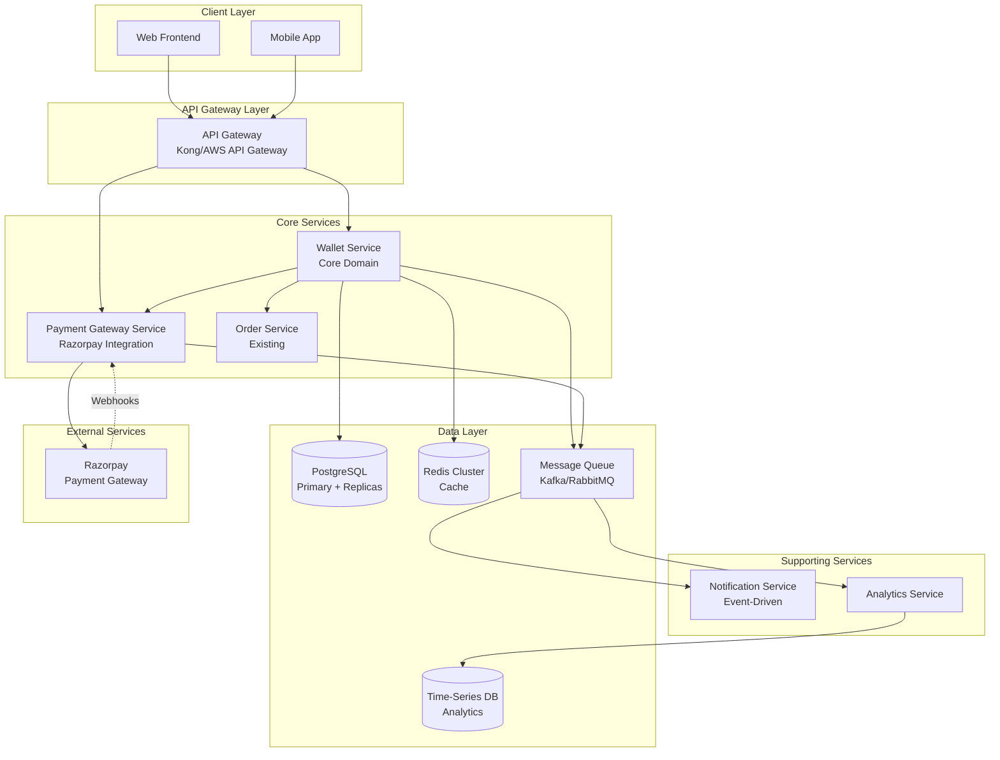
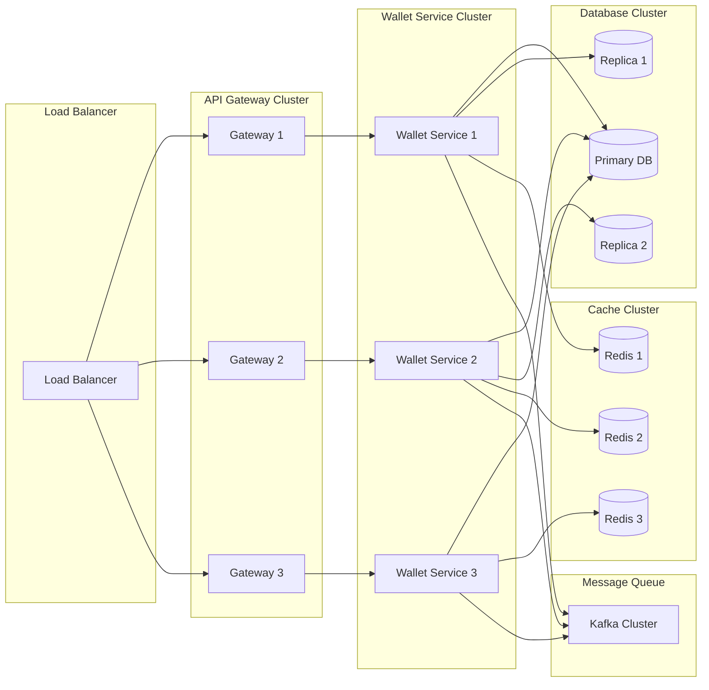
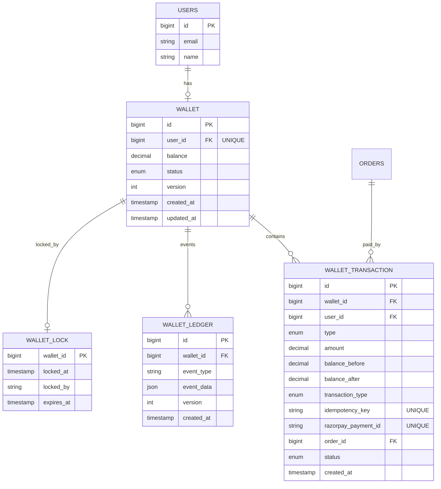
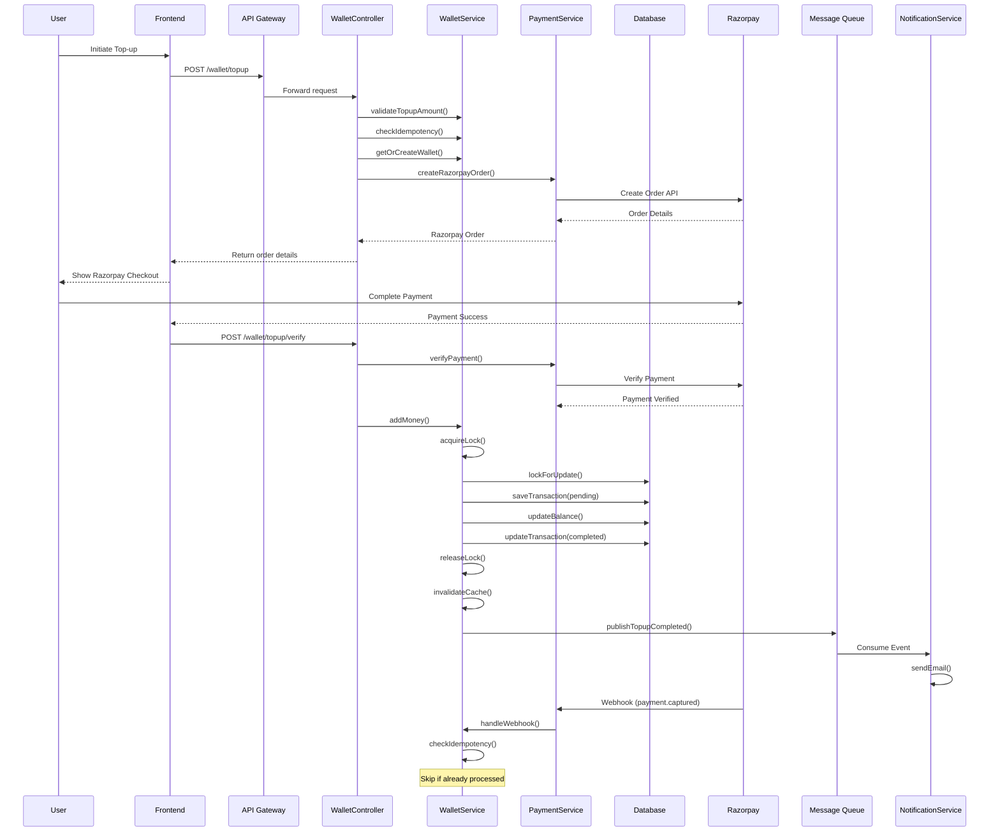
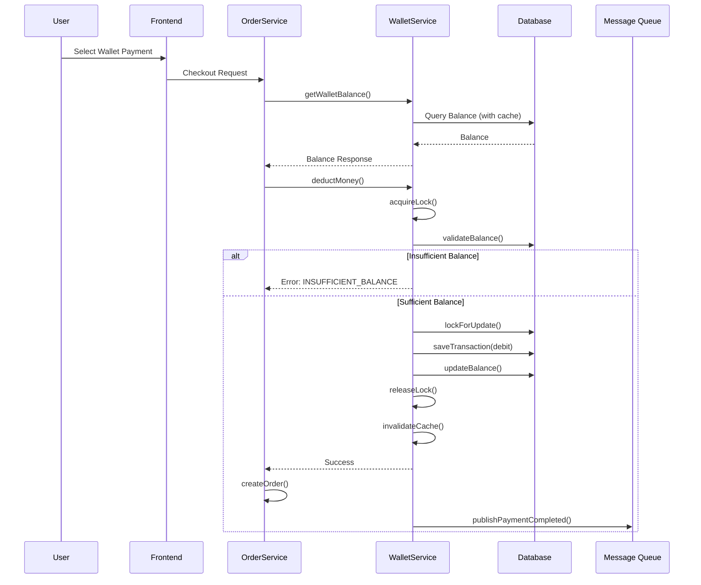
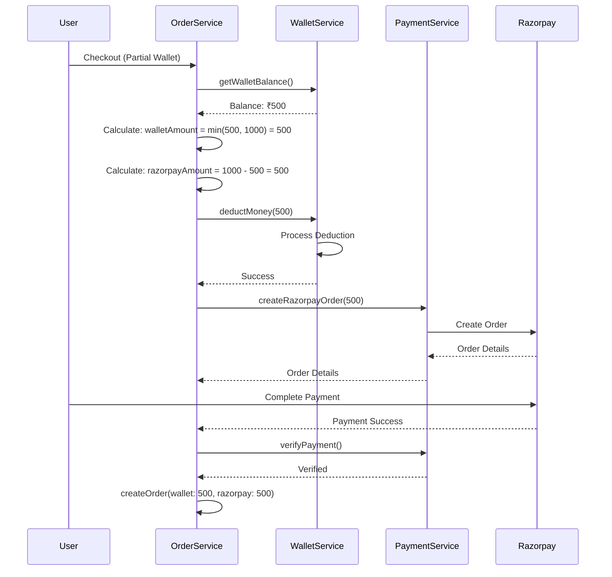
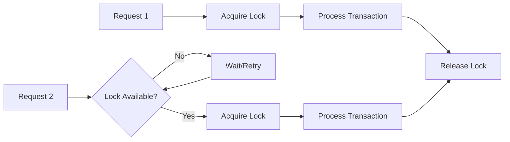
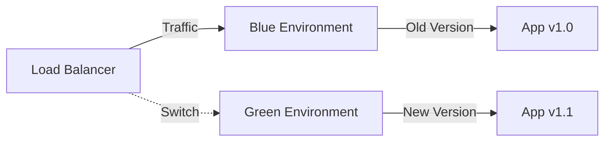

# 💳 Wallet Feature - Software Architecture Design Document

<div align="center">


**End-to-End Wallet Feature for E-Commerce Platform**

*Scalable, Production-Ready Architecture Design*

</div>

---

## 🚀 How to Use This Document

### For AI Coding Assistants (Claude Code, OpenAI Codex, etc.)

**This is a complete, self-contained implementation prompt.** Copy the entire document and provide it to your AI assistant with the following instruction:

> "I have an existing e-commerce codebase with catalog, cart, checkout, and Razorpay integration already working. Implement a complete Wallet feature based on the requirements in this document. Analyze the existing codebase first, then implement all features following existing patterns. Assume sensible defaults where not specified. Generate production-ready code with proper error handling, tests, and documentation."

### For Human Developers

This document serves as:
1. **Complete Requirements Specification** - All features and edge cases covered
2. **Architecture Guide** - System design and scalability considerations
3. **Implementation Reference** - Detailed API specs, database schema, and data flows
4. **One-Shot Implementation Plan** - Everything needed to build the feature end-to-end

### Key Success Factors

✅ **Analyze First**: Understand existing codebase patterns before implementing  
✅ **Follow Patterns**: Match existing code style, structure, and conventions  
✅ **Integrate Seamlessly**: Extend existing systems, don't replace them  
✅ **Handle Edge Cases**: All edge cases documented with handling strategies  
✅ **Production Ready**: Include error handling, validation, tests, and logging  

---

## 📋 Table of Contents

- [Overview](#-overview)
- [High-Level Architecture](#-high-level-architecture)
- [System Architecture Diagram](#-system-architecture-diagram)
- [Scalability Design Patterns](#-scalability-design-patterns)
- [Database Schema](#-database-schema)
- [Class Diagram](#-class-diagram)
- [Data Flow Diagrams](#-data-flow-diagrams)
- [API Design Documentation](#-api-design-documentation)
- [Edge Cases & Handling](#-edge-cases--handling-strategies)
- [Microservice Architecture](#-microservice-architecture-details)
- [Performance Targets](#-performance-targets)
- [Security & Compliance](#-security--compliance)
- [Testing Strategy](#-testing-strategy)
- [Deployment & Operations](#-deployment--operations)
- [Monitoring & Observability](#-monitoring--observability)
- [Implementation Roadmap](#-implementation-roadmap)

---

## 🎯 Overview

### Context & Prerequisites

**IMPORTANT**: You are implementing a Wallet feature for an **existing, functioning e-commerce codebase** that already has:

- ✅ **Catalog system** - Product listings, search, filters
- ✅ **Shopping cart** - Add/remove items, cart persistence
- ✅ **Checkout flow** - Order creation, address management
- ✅ **Razorpay Checkout integration** - Direct payment processing already working
- ✅ **User authentication** - Login, registration, session management
- ✅ **Order management** - Order history, status tracking


### Purpose

This is a **single, self-contained implementation prompt** designed to be copy-pasted into an AI coding assistant (Claude Code, OpenAI Codex, etc.) to implement a complete, production-ready Wallet feature **in one shot** with zero follow-ups required.

**Key Principles:**
- Assume sensible defaults for all unspecified details
- Follow existing codebase patterns and conventions
- Integrate seamlessly with existing Razorpay implementation
- Production-ready code with proper error handling
- Comprehensive edge case handling
- Scalable architecture from day one

### Objectives

- ✅ Enable users to add money to wallet via Razorpay (reuse existing Razorpay integration)
- ✅ Allow wallet balance viewing and transaction history
- ✅ Support wallet payments (full and partial) during checkout
- ✅ Integrate with existing checkout flow (minimal changes)
- ✅ Ensure high availability and horizontal scalability
- ✅ Handle millions of transactions with sub-second response times
- ✅ Maintain data consistency and integrity
- ✅ Provide comprehensive audit trail

### Implementation Instructions

**For AI Assistant**: This document contains complete requirements to implement an end-to-end Wallet feature. Follow these guidelines:

1. **Analyze Existing Codebase First**: 
   - Examine existing Razorpay integration patterns
   - Understand current checkout flow structure
   - Identify database schema and ORM patterns
   - Review authentication/authorization mechanisms
   - Study existing API patterns and conventions

2. **Follow Existing Patterns**:
   - Use the same database technology (PostgreSQL/MySQL/etc.)
   - Follow existing ORM patterns (ActiveRecord/TypeORM/Sequelize/etc.)
   - Match existing API response formats
   - Use same authentication middleware
   - Follow existing error handling patterns

3. **Assume Sensible Defaults**:
   - If framework not specified, infer from existing codebase
   - Use existing database connection patterns
   - Follow existing logging and monitoring setup
   - Use existing testing framework and patterns
   - Match existing code style and conventions

4. **Integration Points**:
   - **Razorpay**: Reuse existing Razorpay SDK initialization and configuration
   - **Checkout**: Extend existing checkout controller/service, don't replace
   - **Orders**: Integrate with existing order creation flow
   - **Users**: Use existing user model/table and authentication

5. **Production Readiness**:
   - Include proper error handling for all edge cases
   - Add input validation and sanitization
   - Implement idempotency for all write operations
   - Add comprehensive logging
   - Include database migrations
   - Add unit and integration tests

### Key Requirements

| Requirement | Target | Notes |
|------------|--------|-------|
| **Users Supported** | 10 million+ | Design for scale |
| **Transactions/Year** | 100 million+ | Optimize queries |
| **Peak Load** | 10x average load | Horizontal scaling |
| **Response Time (p95)** | < 500ms | Caching strategy |
| **Availability** | 99.9% uptime | High availability |
| **Data Consistency** | Strong consistency | For balance updates |

---

## 🏗️ High-Level Architecture

### Architecture Approach

**IMPORTANT**: The architecture should **match your existing codebase structure**:

- **If existing codebase is monolithic**: Implement wallet as additional modules/services within the monolith
- **If existing codebase uses microservices**: Implement wallet as a separate microservice
- **If existing codebase is modular monolith**: Implement wallet as a new module/bounded context

**Default Approach**: If codebase structure is unclear, implement as **modular extension** of existing codebase (add wallet module/service, extend existing controllers).

### Component Architecture Overview

The wallet system consists of the following components (implement based on existing codebase structure):



### Component Responsibilities

| Component | Responsibility | Technology |
|-----------|---------------|------------|
| **API Gateway** | Request routing, auth, rate limiting, circuit breaker | Kong / AWS API Gateway |
| **Wallet Service** | Balance management, transaction processing, business logic | Spring Boot / Go / Node.js |
| **Payment Service** | Razorpay integration, webhook processing, reconciliation | Same as Wallet Service |
| **Notification Service** | Email/SMS/Push notifications | Event-driven consumer |
| **Database** | Transactional data storage | PostgreSQL with read replicas |
| **Cache** | Balance caching, session management | Redis Cluster |
| **Message Queue** | Event bus, async processing | Kafka / RabbitMQ / AWS SQS |

---

## 🎨 System Architecture Diagram



---

## ⚡ Scalability Design Patterns

### 1. Database Scaling Strategy

#### Sharding Strategy
- **Method**: Consistent hashing by `user_id`
- **Shard Count**: Start with 4 shards, scale to 16+ as needed
- **Shard Key**: `hash(user_id) % shard_count`

#### Partitioning Strategy
- **Table**: `wallet_transactions`
- **Partition Key**: `created_at` (monthly partitions)
- **Benefits**: Faster queries, easier archival

#### Read-Write Splitting
- **Writes**: Always to primary database
- **Reads**: Route to read replicas (2-3 replicas)
- **Connection Pooling**: Max 100 connections per instance

#### Database Indexes

| Index Name | Columns | Purpose |
|-----------|---------|---------|
| `idx_user_created` | `(user_id, created_at DESC)` | Transaction history queries |
| `idx_wallet_status_created` | `(wallet_id, status, created_at)` | Pending transaction queries |
| `idx_razorpay_payment_id` | `(razorpay_payment_id)` UNIQUE | Prevent duplicate top-ups |
| `idx_pending_status` | `(status)` WHERE `status = 'pending'` | Fast pending transaction lookup |

### 2. Caching Strategy

#### Multi-Level Caching

```
┌─────────────────────────────────────┐
│  L1 Cache (In-Memory)               │
│  - Active user balances             │
│  - TTL: 1 minute                    │
└──────────────┬──────────────────────┘
               │
               ▼
┌─────────────────────────────────────┐
│  L2 Cache (Redis)                   │
│  - Wallet balances                  │
│  - TTL: 5 minutes                   │
│  - Transaction summaries            │
│  - TTL: 10 minutes                  │
└─────────────────────────────────────┘
```

#### Cache Key Patterns

```
wallet:balance:{user_id}
wallet:txn:{user_id}:{page}:{limit}
wallet:status:{user_id}
wallet:lock:{wallet_id}
```

#### Cache Invalidation
- **Write-Through**: Update cache on write
- **TTL-Based**: Automatic expiration
- **Event-Based**: Invalidate on balance changes

### 3. Async Processing

#### Critical vs Non-Critical Paths

| Operation | Path | Processing |
|-----------|------|------------|
| Balance updates | Critical | Synchronous |
| Transaction creation | Critical | Synchronous |
| Notifications | Non-Critical | Asynchronous |
| Analytics | Non-Critical | Asynchronous |
| Audit logs | Non-Critical | Asynchronous |

#### Message Queue Topics

```
wallet.topup.completed
wallet.payment.completed
wallet.refund.completed
wallet.transaction.failed
wallet.balance.low
```

### 4. Load Balancing & High Availability

- **Minimum Instances**: 3 per service
- **Health Checks**: `/health`, `/ready` endpoints
- **Auto-Scaling**: Based on CPU, memory, request rate
- **Multi-Region**: Active-active deployment
- **Database Failover**: Automatic with < 30s downtime

### 5. Rate Limiting & Throttling

| Endpoint | Per User Limit | Per IP Limit |
|----------|---------------|--------------|
| Balance Check | 100/min | 1000/min |
| Top-up Initiation | 10/hour | 100/hour |
| Transaction History | 50/min | 500/min |
| Payment Verification | 20/min | 200/min |

**Algorithm**: Sliding window with Redis

### 6. Idempotency & Concurrency Control

#### Idempotency Keys
- Format: `{operation}:{user_id}:{unique_id}`
- Storage: Redis with 24-hour TTL
- Validation: Check before processing

#### Concurrency Control
- **Distributed Locks**: Redis-based (30s timeout)
- **Optimistic Locking**: Version field in wallet table
- **Database Locks**: `SELECT FOR UPDATE` for critical operations
- **Isolation Level**: `READ COMMITTED` (or `SERIALIZABLE` for critical ops)

---

## 🗄️ Database Schema

### Entity Relationship Diagram



### Table Definitions

#### `wallet` Table

| Column | Type | Constraints | Description |
|--------|------|-------------|-------------|
| `id` | BIGINT | PRIMARY KEY, AUTO_INCREMENT | Wallet identifier |
| `user_id` | BIGINT | UNIQUE, FOREIGN KEY → users.id | User identifier |
| `balance` | DECIMAL(12,2) | DEFAULT 0.00 | Current balance |
| `status` | ENUM | DEFAULT 'active' | Wallet status |
| `version` | INTEGER | DEFAULT 1 | Optimistic locking version |
| `locked_at` | TIMESTAMP | NULLABLE | Lock timestamp |
| `locked_by` | VARCHAR(100) | NULLABLE | Instance holding lock |
| `created_at` | TIMESTAMP | DEFAULT CURRENT_TIMESTAMP | Creation time |
| `updated_at` | TIMESTAMP | ON UPDATE CURRENT_TIMESTAMP | Last update time |
| `deleted_at` | TIMESTAMP | NULLABLE | Soft delete timestamp |

**Indexes:**
- `PRIMARY KEY (id)`
- `UNIQUE INDEX idx_user_id (user_id)`
- `INDEX idx_status_created (status, created_at)`
- `INDEX idx_user_status (user_id, status)`

#### `wallet_transactions` Table (Partitioned by Month)

| Column | Type | Constraints | Description |
|--------|------|-------------|-------------|
| `id` | BIGINT | PRIMARY KEY | Transaction identifier |
| `wallet_id` | BIGINT | FOREIGN KEY → wallet.id | Wallet reference |
| `user_id` | BIGINT | FOREIGN KEY → users.id | User reference |
| `type` | ENUM('credit', 'debit') | NOT NULL | Transaction type |
| `amount` | DECIMAL(12,2) | NOT NULL | Transaction amount |
| `balance_before` | DECIMAL(12,2) | NOT NULL | Balance before transaction |
| `balance_after` | DECIMAL(12,2) | NOT NULL | Balance after transaction |
| `transaction_type` | ENUM | NOT NULL | Transaction category |
| `reference_id` | VARCHAR(255) | NULLABLE | External reference |
| `idempotency_key` | VARCHAR(255) | UNIQUE, NULLABLE | Idempotency key |
| `description` | TEXT | NULLABLE | Transaction description |
| `status` | ENUM | DEFAULT 'pending' | Transaction status |
| `razorpay_payment_id` | VARCHAR(255) | UNIQUE, NULLABLE | Razorpay payment ID |
| `razorpay_order_id` | VARCHAR(255) | NULLABLE | Razorpay order ID |
| `order_id` | BIGINT | FOREIGN KEY → orders.id, NULLABLE | Order reference |
| `metadata` | JSON | NULLABLE | Additional data |
| `created_at` | TIMESTAMP | DEFAULT CURRENT_TIMESTAMP | Creation time |
| `updated_at` | TIMESTAMP | ON UPDATE CURRENT_TIMESTAMP | Update time |

**Partitioning:**
```sql
PARTITION BY RANGE (YEAR(created_at), MONTH(created_at))
```

**Indexes:**
- `PRIMARY KEY (id, created_at)` - Composite for partitioning
- `INDEX idx_wallet_created (wallet_id, created_at DESC)`
- `INDEX idx_user_created (user_id, created_at DESC)`
- `UNIQUE INDEX idx_idempotency_key (idempotency_key)`
- `UNIQUE INDEX idx_razorpay_payment_id (razorpay_payment_id)`
- `INDEX idx_status_created (status, created_at)`

#### `wallet_ledger` Table (Event Sourcing)

| Column | Type | Description |
|--------|------|-------------|
| `id` | BIGINT | Event identifier |
| `wallet_id` | BIGINT | Wallet reference |
| `user_id` | BIGINT | User reference |
| `event_type` | VARCHAR(50) | Event type |
| `event_data` | JSON | Complete event payload |
| `version` | INTEGER | Event version |
| `created_at` | TIMESTAMP | Event timestamp |

---

## 📐 Class Diagram

```mermaid
classDiagram
    class WalletService {
        +getOrCreateWallet(userId) Wallet
        +getWalletBalance(userId) BigDecimal
        +addMoney(request) TransactionResult
        +deductMoney(request) TransactionResult
        +refundToWallet(request) TransactionResult
        +getTransactionHistory(request) PagedResult
        +validateWalletStatus(userId) WalletStatus
        +lockWallet(walletId, timeout) LockResult
        +unlockWallet(walletId) void
    }
    
    class WalletRepository {
        +findById(walletId) Optional~Wallet~
        +findByUserId(userId) Optional~Wallet~
        +create(wallet) Wallet
        +update(wallet) Wallet
        +updateBalance(walletId, amount, version) Boolean
        +lockForUpdate(walletId) Optional~Wallet~
    }
    
    class TransactionRepository {
        +save(transaction) WalletTransaction
        +findById(transactionId) Optional~WalletTransaction~
        +findByWalletId(walletId, page) List~WalletTransaction~
        +findByUserId(userId, page) List~WalletTransaction~
        +findByRazorpayPaymentId(paymentId) Optional~WalletTransaction~
        +findByIdempotencyKey(key) Optional~WalletTransaction~
        +findPendingTransactions(limit) List~WalletTransaction~
    }
    
    class PaymentService {
        +createRazorpayOrder(amount, currency) RazorpayOrder
        +verifyPayment(paymentId, orderId, signature) Boolean
        +getPaymentStatus(paymentId) PaymentStatus
        +processRefund(paymentId, amount) RefundResult
        +handleWebhook(event) void
    }
    
    class WalletLockService {
        +acquireLock(walletId, timeout) LockHandle
        +releaseLock(lockHandle) void
        +extendLock(lockHandle, duration) Boolean
    }
    
    class CacheService {
        +getBalance(userId) Optional~BigDecimal~
        +setBalance(userId, balance, ttl) void
        +invalidateBalance(userId) void
        +getTransactionSummary(userId) Optional~TransactionSummary~
        +setTransactionSummary(userId, summary, ttl) void
    }
    
    class EventPublisher {
        +publishWalletTopupCompleted(event) void
        +publishWalletPaymentCompleted(event) void
        +publishWalletRefundCompleted(event) void
        +publishTransactionFailed(event) void
    }
    
    class WalletValidator {
        +validateTopupAmount(amount) ValidationResult
        +validateWalletBalance(wallet, amount) ValidationResult
        +validateWalletStatus(wallet) ValidationResult
        +validateTransactionLimits(userId, amount) ValidationResult
    }
    
    class IdempotencyService {
        +generateKey(operation, params) String
        +checkAndReserve(key, ttl) Boolean
        +markCompleted(key, result) void
        +getResult(key) Optional~Object~
    }
    
    class WalletController {
        +getBalance() ResponseEntity~BalanceResponse~
        +getTransactions(request) ResponseEntity~PagedResponse~
        +initiateTopup(request) ResponseEntity~TopupResponse~
        +verifyTopup(request) ResponseEntity~TopupVerifyResponse~
        +getTopupStatus(transactionId) ResponseEntity~TransactionStatusResponse~
    }
    
    WalletService --> WalletRepository
    WalletService --> TransactionRepository
    WalletService --> PaymentService
    WalletService --> EventPublisher
    WalletService --> CacheService
    WalletService --> WalletLockService
    WalletService --> WalletValidator
    WalletService --> IdempotencyService
    WalletController --> WalletService
    PaymentService --> RazorpaySDK
```



---

## 🔄 Data Flow Diagrams

### Wallet Top-Up Flow



### Wallet Payment Flow



### Partial Wallet + Razorpay Payment Flow



---

## 📡 API Design Documentation

### Base Configuration

```
Base URL: https://api.example.com/v1/wallet
Authentication: Bearer Token (JWT)
Content-Type: application/json
```

### Rate Limits

| Endpoint | Per User | Per IP |
|----------|----------|--------|
| Balance Check | 100/min | 1000/min |
| Top-up Initiation | 10/hour | 100/hour |
| Transaction History | 50/min | 500/min |

### Endpoints

#### 1. Get Wallet Balance

```http
GET /wallet/balance
Authorization: Bearer {token}
X-Request-ID: {uuid}
```

**Response 200 OK:**
```json
{
  "success": true,
  "data": {
    "balance": 5000.00,
    "currency": "INR",
    "status": "active",
    "last_updated": "2024-01-15T10:30:00Z"
  },
  "metadata": {
    "request_id": "uuid",
    "timestamp": "2024-01-15T10:30:00Z"
  }
}
```

#### 2. Get Transaction History

```http
GET /wallet/transactions?page=1&limit=20&transaction_type=topup&sort=desc
Authorization: Bearer {token}
```

**Query Parameters:**

| Parameter | Type | Default | Description |
|-----------|------|---------|-------------|
| `page` | integer | 1 | Page number |
| `limit` | integer | 20 | Items per page (max 100) |
| `transaction_type` | string | - | Filter by type |
| `status` | string | - | Filter by status |
| `start_date` | ISO 8601 | - | Start date filter |
| `end_date` | ISO 8601 | - | End date filter |
| `sort` | string | desc | Sort order (asc/desc) |

**Response 200 OK:**
```json
{
  "success": true,
  "data": {
    "transactions": [
      {
        "id": 12345,
        "type": "credit",
        "transaction_type": "topup",
        "amount": 1000.00,
        "balance_before": 4000.00,
        "balance_after": 5000.00,
        "status": "completed",
        "description": "Wallet top-up via Razorpay",
        "reference_id": "pay_abc123",
        "created_at": "2024-01-15T10:30:00Z"
      }
    ],
    "pagination": {
      "page": 1,
      "limit": 20,
      "total": 150,
      "total_pages": 8,
      "has_next": true,
      "has_prev": false
    }
  }
}
```

#### 3. Initiate Top-up

```http
POST /wallet/topup
Authorization: Bearer {token}
X-Idempotency-Key: {uuid}
Content-Type: application/json

{
  "amount": 1000.00,
  "currency": "INR"
}
```

**Validation Rules:**
- `amount`: Required, decimal, min: 100.00, max: 50000.00
- `currency`: Required, must be "INR"

**Response 200 OK:**
```json
{
  "success": true,
  "data": {
    "transaction_id": 12345,
    "razorpay_order_id": "order_abc123",
    "amount": 1000.00,
    "currency": "INR",
    "razorpay_key": "rzp_test_xxx",
    "name": "Example Company",
    "description": "Wallet top-up",
    "prefill": {
      "email": "user@example.com",
      "contact": "9123456789"
    }
  }
}
```

#### 4. Verify Top-up

```http
POST /wallet/topup/verify
Authorization: Bearer {token}
X-Idempotency-Key: {uuid}
Content-Type: application/json

{
  "razorpay_payment_id": "pay_abc123",
  "razorpay_order_id": "order_abc123",
  "razorpay_signature": "signature_hash"
}
```

**Response 200 OK:**
```json
{
  "success": true,
  "data": {
    "transaction_id": 12345,
    "status": "completed",
    "amount": 1000.00,
    "new_balance": 5000.00,
    "razorpay_payment_id": "pay_abc123"
  }
}
```

#### 5. Deduct Money (Internal API)

```http
POST /wallet/deduct
Authorization: Bearer {service_token}
X-Idempotency-Key: {uuid}
Content-Type: application/json

{
  "user_id": 12345,
  "amount": 500.00,
  "order_id": 67890,
  "description": "Payment for order #67890"
}
```

**Response 200 OK:**
```json
{
  "success": true,
  "data": {
    "transaction_id": 12346,
    "status": "completed",
    "amount": 500.00,
    "balance_before": 5000.00,
    "balance_after": 4500.00
  }
}
```

**Response 400 Bad Request:**
```json
{
  "success": false,
  "error": {
    "code": "INSUFFICIENT_BALANCE",
    "message": "Insufficient wallet balance",
    "current_balance": 300.00,
    "required_amount": 500.00
  }
}
```

### Error Response Format

```json
{
  "success": false,
  "error": {
    "code": "ERROR_CODE",
    "message": "Human-readable error message",
    "details": {}
  },
  "metadata": {
    "request_id": "uuid",
    "timestamp": "ISO 8601 datetime"
  }
}
```

### Common Error Codes

| Code | HTTP Status | Description |
|------|-------------|-------------|
| `UNAUTHORIZED` | 401 | Authentication failed |
| `FORBIDDEN` | 403 | Insufficient permissions |
| `NOT_FOUND` | 404 | Resource not found |
| `VALIDATION_ERROR` | 400 | Request validation failed |
| `INSUFFICIENT_BALANCE` | 400 | Wallet balance insufficient |
| `RATE_LIMIT_EXCEEDED` | 429 | Rate limit exceeded |
| `DUPLICATE_TRANSACTION` | 409 | Transaction already processed |
| `PAYMENT_VERIFICATION_FAILED` | 400 | Payment verification failed |
| `INTERNAL_ERROR` | 500 | Internal server error |
| `SERVICE_UNAVAILABLE` | 503 | Service temporarily unavailable |

---

## ⚠️ Edge Cases & Handling Strategies

### Critical Edge Cases

| # | Edge Case | Handling Strategy | Impact |
|---|-----------|-------------------|--------|
| 1 | **Concurrent Transactions** | Distributed locks + optimistic locking + retry | High |
| 2 | **Duplicate Payment Processing** | Unique constraint + idempotency keys | Critical |
| 3 | **Partial Payment Failure** | Saga pattern + compensating transactions | High |
| 4 | **Webhook Delay/Failure** | Polling + reconciliation job + alerts | Medium |
| 5 | **Network Partition** | Circuit breaker + graceful degradation | High |
| 6 | **Database Deadlock** | Lock ordering + retry + monitoring | Medium |
| 7 | **Cache Inconsistency** | Write-through + invalidation + short TTL | Medium |
| 8 | **Balance Overflow** | Pre-validation + clear errors | Low |
| 9 | **Negative Balance Attempt** | Pre-validation + error response | Medium |
| 10 | **Expired Locks** | Auto-cleanup + force unlock endpoint | Medium |

### Detailed Handling Strategies

#### 1. Concurrent Transactions

**Scenario**: Multiple requests try to update same wallet simultaneously

**Handling**:


- Use distributed locks (Redis) with 30s timeout
- Database row-level locking (`SELECT FOR UPDATE`)
- Optimistic locking with version field
- Retry mechanism with exponential backoff
- Transaction isolation: `SERIALIZABLE` for critical operations

#### 2. Duplicate Payment Processing

**Scenario**: Same Razorpay payment processed multiple times

**Handling**:
- Unique constraint on `razorpay_payment_id`
- Idempotency key checking before processing
- Check existing transaction before creating new one
- Return existing transaction if duplicate detected

#### 3. Partial Payment Failure

**Scenario**: Wallet deduction succeeds but Razorpay payment fails

**Handling**:
- Use Saga pattern for distributed transactions
- Compensating transaction: Auto-refund wallet if Razorpay fails
- Two-phase commit: Reserve wallet amount, commit on Razorpay success
- Timeout mechanism: Auto-refund if Razorpay doesn't complete in 15 minutes

---

## 🏛️ Microservice Architecture Details

### Service Boundaries

#### Wallet Service (Core Domain)

**Responsibilities:**
- Wallet balance management
- Transaction processing
- Business rule enforcement
- Event publishing

**Technology Stack:**
- Language: Java/Go/Node.js
- Framework: Spring Boot / Gin / Express
- Database: PostgreSQL (primary), Redis (cache)
- Message Queue: Kafka / RabbitMQ

**Scalability:**
- Horizontal scaling: Stateless design
- Database: Read replicas + sharding
- Cache: Redis cluster
- Load balancing: Round-robin with health checks

#### Payment Gateway Service

**Responsibilities:**
- Razorpay integration abstraction
- Payment gateway switching capability
- Webhook processing
- Payment reconciliation

**Technology Stack:**
- Language: Same as wallet service
- External SDK: Razorpay SDK
- Database: PostgreSQL (for payment records)

#### Notification Service

**Responsibilities:**
- Email notifications
- SMS notifications (optional)
- Push notifications (optional)
- Template management

**Technology Stack:**
- Message Queue Consumer: Kafka consumer / RabbitMQ consumer
- Email: SendGrid / AWS SES
- SMS: Twilio / AWS SNS

### Service Communication Patterns

#### Synchronous Communication (REST API)

**Use Cases:**
- Order service → Wallet service (deduct money)
- Frontend → Wallet service (balance check, top-up)

**Patterns:**
- Request/Response
- Timeout: 5 seconds
- Retry: 3 attempts with exponential backoff
- Circuit breaker: Open after 5 failures

#### Asynchronous Communication (Message Queue)

**Use Cases:**
- Wallet service → Notification service (events)
- Wallet service → Analytics service (events)

**Patterns:**
- Event-driven architecture
- At-least-once delivery
- Dead letter queue for failed messages
- Message ordering: Not required (use idempotency)

### Deployment Architecture

#### Containerization
- Docker containers for all services
- Multi-stage builds for smaller images
- Health check configuration
- Resource limits (CPU, memory)

#### Orchestration
- Kubernetes for container orchestration
- Deployment strategy: Rolling update
- Auto-scaling: HPA (Horizontal Pod Autoscaler)
- Service mesh: Istio / Linkerd (optional)

#### Database Deployment
- Managed database service (AWS RDS / Google Cloud SQL)
- Read replicas: 2-3 replicas
- Automated backups: Daily with point-in-time recovery
- Multi-AZ deployment for high availability

---

## 🎯 Performance Targets

### Response Time Targets (p95)

| Operation | Target | Measurement |
|-----------|--------|-------------|
| Balance Check | < 100ms | End-to-end |
| Transaction History | < 200ms | End-to-end |
| Top-up Initiation | < 300ms | End-to-end |
| Payment Verification | < 500ms | End-to-end |
| Wallet Deduction | < 200ms | End-to-end |

### Throughput Targets

| Operation | Target | Notes |
|-----------|--------|-------|
| Balance Checks | 10,000 req/s | With caching |
| Transaction Processing | 5,000 txn/s | Peak capacity |
| Top-up Processing | 1,000 top-ups/s | With rate limiting |

### Availability Targets

| Metric | Target |
|--------|-------|
| Uptime | 99.9% (8.76 hours downtime/year) |
| SLA | 99.95% for critical operations |
| MTTR | < 15 minutes |

### Scalability Limits

| Metric | Target |
|--------|-------|
| Users Supported | 10 million+ |
| Transactions/Year | 100 million+ |
| Peak Load | 10x average load |
| Database Size | 1TB+ |

---

## 🔒 Security & Compliance

### Security Measures

#### Authentication & Authorization
- ✅ JWT-based authentication for all endpoints
- ✅ Service-to-service authentication (API keys)
- ✅ Role-based access control (RBAC)
- ✅ User ownership verification

#### Data Protection
- ✅ Encryption at rest (AES-256)
- ✅ Encryption in transit (TLS 1.2+)
- ✅ Key management (AWS KMS / HashiCorp Vault)
- ✅ Parameterized queries (SQL injection prevention)
- ✅ Input validation and sanitization

#### Rate Limiting & DDoS Protection
- ✅ Per-user rate limits
- ✅ Per-IP rate limits
- ✅ DDoS protection at API Gateway
- ✅ Request throttling

#### Webhook Security
- ✅ Signature verification for Razorpay webhooks
- ✅ Idempotency handling
- ✅ Replay attack prevention

### Compliance

| Requirement | Implementation |
|-------------|----------------|
| **GDPR** | Right to deletion, data portability |
| **PCI DSS** | If storing payment data |
| **KYC/AML** | If required by regulations |
| **Audit Trail** | 7 years retention |
| **Data Export** | CSV/PDF export for users |

---

## 🧪 Testing Strategy

### Test Pyramid

```
        /\
       /E2E\         10%
      /------\
     /Integration\   20%
    /------------\
   /   Unit Tests  \  70%
  /----------------\
```

### Testing Levels

#### 1. Unit Tests (70%)
- **Coverage**: Minimum 80%
- **Scope**: Service methods, validators, utilities
- **Tools**: JUnit / Go testing / Jest
- **Mocking**: Mock external dependencies

#### 2. Integration Tests (20%)
- **Scope**: Database, cache, message queue
- **Tools**: Testcontainers / Docker Compose
- **Focus**: Transaction flows, webhook processing

#### 3. E2E Tests (10%)
- **Scope**: Complete user flows
- **Tools**: Cypress / Playwright / Selenium
- **Scenarios**: Top-up, payment, refund flows

#### 4. Performance Tests
- **Load Testing**: 10x average load
- **Stress Testing**: Find breaking point
- **Endurance Testing**: 24-hour continuous load
- **Tools**: JMeter / k6 / Gatling

#### 5. Security Tests
- **Penetration Testing**: Annual
- **Vulnerability Scanning**: Automated
- **OWASP Top 10**: Compliance check

---

## 🚀 Deployment & Operations

### Deployment Strategy

#### Blue-Green Deployment


#### Canary Deployment
- **Phase 1**: 10% traffic to new version
- **Phase 2**: 50% traffic (if metrics OK)
- **Phase 3**: 100% traffic

### Deployment Checklist

- [ ] Run database migrations
- [ ] Deploy backend changes
- [ ] Deploy frontend changes
- [ ] Update Razorpay webhook URL
- [ ] Test webhook endpoint
- [ ] Monitor error logs
- [ ] Set up alerts
- [ ] Verify cache is working
- [ ] Load test in staging
- [ ] Smoke tests after deployment

### Rollback Plan

1. **Database Migration Rollback**: Version-controlled scripts
2. **Service Rollback**: Revert to previous container image
3. **Feature Flag Disable**: Instant feature disable
4. **Data Consistency Verification**: Post-rollback checks

---

## 📊 Monitoring & Observability

### Three Pillars of Observability

#### 1. Metrics (Prometheus)

**Business Metrics:**
- Wallet adoption rate
- Average wallet balance
- Top-up frequency
- Transaction volume

**Technical Metrics:**
- Request rate, latency (p50, p95, p99)
- Error rates by endpoint
- Database query performance
- Cache hit/miss ratio
- Message queue lag

#### 2. Logs (ELK Stack)

**Structured Logging:**
```json
{
  "timestamp": "2024-01-15T10:30:00Z",
  "level": "INFO",
  "service": "wallet-service",
  "trace_id": "abc123",
  "user_id": 12345,
  "message": "Wallet balance updated",
  "metadata": {
    "wallet_id": 67890,
    "amount": 1000.00
  }
}
```

#### 3. Traces (Jaeger/Zipkin)

- Distributed tracing across services
- Performance bottleneck identification
- Request flow visualization

### Alerting Rules

| Alert | Condition | Severity |
|-------|-----------|----------|
| High Error Rate | Error rate > 1% | Critical |
| High Latency | p95 > 1 second | Warning |
| Failed Transactions | Failed top-ups > 10/min | Critical |
| Service Down | Health check fails | Critical |
| Database Issues | Connection errors | Critical |

### Dashboards

1. **Real-time Operations Dashboard**
   - Current transaction rate
   - Active users
   - Error rates

2. **Business Metrics Dashboard**
   - Wallet adoption
   - Average balance
   - Transaction trends

3. **Performance Dashboard**
   - Response times
   - Throughput
   - Resource utilization

---

## 🗺️ Implementation Roadmap

### Phase 1: Foundation (Weeks 1-2)

**Deliverables:**
- ✅ Database schema design and migration
- ✅ Core wallet service implementation
- ✅ Basic API endpoints (balance, transactions)
- ✅ Unit tests and integration tests

**Success Criteria:**
- All tests passing
- Database migrations successful
- Basic CRUD operations working

### Phase 2: Top-up Flow (Weeks 3-4)

**Deliverables:**
- ✅ Razorpay integration for top-up
- ✅ Top-up API endpoints
- ✅ Webhook processing
- ✅ Frontend top-up flow
- ✅ End-to-end testing

**Success Criteria:**
- Users can add money to wallet
- Webhooks processed correctly
- Payment verification working

### Phase 3: Payment Integration (Weeks 5-6)

**Deliverables:**
- ✅ Checkout integration
- ✅ Wallet payment option
- ✅ Partial payment support
- ✅ Order service integration
- ✅ End-to-end testing

**Success Criteria:**
- Users can pay with wallet
- Partial payments working
- Order creation successful

### Phase 4: Polish & Optimization (Weeks 7-8)

**Deliverables:**
- ✅ Transaction history UI
- ✅ Filters and search
- ✅ Caching implementation
- ✅ Performance optimization
- ✅ Monitoring and alerting setup

**Success Criteria:**
- Response times meet targets
- Cache hit rate > 80%
- Monitoring dashboards live

### Phase 5: Scale & Production Readiness (Weeks 9-12)

**Deliverables:**
- ✅ Load testing and optimization
- ✅ Security hardening
- ✅ Documentation
- ✅ Production deployment
- ✅ Monitoring and maintenance

**Success Criteria:**
- System handles 10x peak load
- Security audit passed
- 99.9% uptime achieved

---

## 📝 Assumptions & Defaults

### Critical Assumptions for Implementation

**IMPORTANT**: When implementing, assume these defaults unless the existing codebase indicates otherwise:

| Category | Assumption | Implementation Note |
|----------|------------|---------------------|
| **Currency** | INR (Indian Rupees) | Use existing currency handling if present |
| **Payment Gateway** | Razorpay (already integrated) | **Reuse existing Razorpay setup** - don't create new integration |
| **Database** | Same as existing codebase | Infer from existing migrations/models |
| **Framework** | Same as existing codebase | Match existing patterns (Django/Express/Spring/etc.) |
| **ORM/Query Builder** | Same as existing codebase | Use existing database access patterns |
| **Authentication** | Existing auth system | Use existing user model and auth middleware |
| **API Style** | RESTful (match existing) | Follow existing endpoint patterns |
| **Error Handling** | Match existing format | Use existing error response structure |
| **Logging** | Existing logging setup | Use existing logging framework |
| **Testing** | Existing test framework | Follow existing test patterns |
| **Cache** | Redis (if available) | Use if already in codebase, otherwise skip for MVP |
| **Message Queue** | Optional for MVP | Implement async notifications if queue exists |

### Business Rule Defaults

| Rule | Default Value | Notes |
|------|---------------|-------|
| **Minimum Top-up** | ₹100 | Enforce in validation |
| **Maximum Top-up** | ₹50,000 per transaction | Enforce in validation |
| **Maximum Wallet Balance** | ₹1,00,000 | Prevent further top-ups if reached |
| **Transaction Limits** | 10 top-ups/hour per user | Rate limiting |
| **Balance Checks** | 100 requests/minute per user | Rate limiting |
| **Cache TTL** | 5 minutes for balance | If caching implemented |

### Integration Assumptions

1. **Existing Razorpay Integration**:
   - Razorpay SDK already initialized
   - Razorpay keys already configured
   - Existing webhook handler exists (extend it)
   - Existing payment verification logic (reuse patterns)

2. **Existing Checkout Flow**:
   - Checkout controller/service exists
   - Order creation logic exists
   - Payment processing flow exists
   - **Action**: Add wallet as additional payment option, don't replace existing flow

3. **Existing User System**:
   - User model/table exists
   - User authentication works
   - User sessions managed
   - **Action**: Add wallet as one-to-one relationship with user

4. **Existing Order System**:
   - Order model/table exists
   - Order status management exists
   - Refund processing exists (if any)
   - **Action**: Link wallet transactions to orders, support refunds to wallet

---

## ✅ Success Criteria

### Functional Requirements
- ✅ Users can add money to wallet via Razorpay
- ✅ Users can view wallet balance and transaction history
- ✅ Users can pay for orders using wallet (full or partial)
- ✅ Wallet balance updates correctly after all operations
- ✅ Transaction history is accurate and complete

### Non-Functional Requirements
- ✅ Response times meet SLA targets (p95 < 500ms)
- ✅ 99.9% uptime achieved
- ✅ System handles 10x peak load without degradation
- ✅ Zero data loss or corruption
- ✅ All transactions are auditable
- ✅ All security measures implemented

---

## 📚 References

### Design Principles
- **Design for Scale**: Horizontal scalability from day one
- **Fail Gracefully**: Handle all edge cases
- **Data Integrity**: Strong consistency for critical operations
- **High Availability**: Multi-region, auto-failover
- **Observability**: Comprehensive monitoring and logging
- **Follow Existing Patterns**: Match codebase conventions

### Key Technologies
- **Architecture**: Match existing codebase (monolith/microservices/modular)
- **Event-Driven**: Async processing for non-critical paths (if message queue exists)
- **CQRS**: Separate read/write models (optional, for scale)
- **Event Sourcing**: Complete audit trail (optional, recommended)

---

## 🎯 Implementation Summary

### What to Implement

This document provides **complete requirements** for implementing a Wallet feature. The implementation should include:

#### 1. Database Layer
- [ ] `wallet` table with balance, status, version fields
- [ ] `wallet_transactions` table (partitioned by month for scale)
- [ ] `wallet_ledger` table (optional, for event sourcing)
- [ ] All necessary indexes for performance
- [ ] Database migrations (version-controlled)

#### 2. Backend Services
- [ ] Wallet service/controller with CRUD operations
- [ ] Transaction processing (add money, deduct money, refund)
- [ ] Razorpay integration for top-ups (reuse existing integration)
- [ ] Webhook handler extension (for Razorpay callbacks)
- [ ] Idempotency handling for all write operations
- [ ] Distributed locking for concurrent transactions
- [ ] Caching layer (if Redis available)

#### 3. API Endpoints
- [ ] `GET /wallet/balance` - Get current balance
- [ ] `GET /wallet/transactions` - Transaction history with pagination
- [ ] `POST /wallet/topup` - Initiate top-up (returns Razorpay order)
- [ ] `POST /wallet/topup/verify` - Verify top-up payment
- [ ] `GET /wallet/topup/status/:id` - Check top-up status
- [ ] `POST /wallet/deduct` - Internal API for order payment
- [ ] `POST /wallet/refund` - Internal API for refunds
- [ ] `POST /webhooks/razorpay` - Extend existing webhook handler

#### 4. Frontend Integration
- [ ] Wallet dashboard page (`/wallet`)
- [ ] Add money/top-up flow with Razorpay Checkout
- [ ] Checkout page modifications (wallet payment option)
- [ ] Transaction history UI with filters
- [ ] Order details page (show wallet payment info)
- [ ] Navigation updates (wallet link in user menu)

#### 5. Business Logic
- [ ] Balance validation (min/max limits)
- [ ] Transaction limits (rate limiting)
- [ ] Concurrent transaction handling
- [ ] Duplicate payment prevention
- [ ] Partial payment support (wallet + Razorpay)
- [ ] Refund processing to wallet

#### 6. Error Handling
- [ ] All edge cases handled gracefully
- [ ] Proper HTTP status codes
- [ ] User-friendly error messages
- [ ] Idempotency for retries
- [ ] Transaction rollback on failures

#### 7. Testing
- [ ] Unit tests for service methods (80%+ coverage)
- [ ] Integration tests for API endpoints
- [ ] E2E tests for complete flows
- [ ] Edge case tests
- [ ] Performance tests (if applicable)

#### 8. Documentation
- [ ] API documentation (OpenAPI/Swagger if applicable)
- [ ] Database schema documentation
- [ ] Setup and deployment instructions
- [ ] Code comments for complex logic

### Implementation Checklist

Before considering implementation complete, verify:

- ✅ All database tables created with proper indexes
- ✅ All API endpoints implemented and tested
- ✅ Razorpay integration working (top-up flow)
- ✅ Webhook processing implemented
- ✅ Checkout integration complete (wallet payment option)
- ✅ Transaction history working with pagination
- ✅ Edge cases handled (concurrent transactions, duplicates, etc.)
- ✅ Error handling comprehensive
- ✅ Tests written and passing
- ✅ Code follows existing codebase patterns
- ✅ Documentation complete

### Final Notes

**This is a complete, self-contained prompt.** An AI assistant should be able to:

1. Analyze the existing codebase structure
2. Implement all components listed above
3. Follow existing patterns and conventions
4. Handle all edge cases documented
5. Generate production-ready code
6. Create necessary tests and documentation

**All without requiring follow-up questions or clarifications.**

---

<div align="center">

**Document Version**: 1.0.0  
**Last Updated**: January 2024  
**Status**: Design Phase  
**Designed By**: Sumit Kumar Mallick

---

*This document is a living document and will be updated as the system evolves.*

</div>

